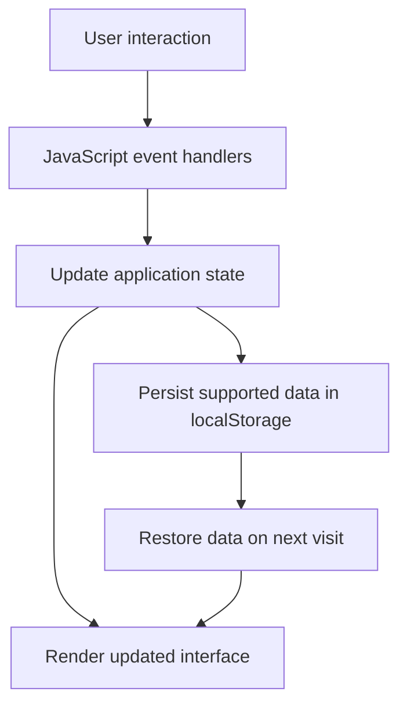

<div align="center">

# TUNTAS
### Personal Productivity & Task Management Web Application

**Organize priorities. Stay focused. Finish what matters.**

A responsive, browser-based productivity application that combines task management, focus sessions, progress notes, and quick access to frequently used resources in one workspace.

[Explore Source Code](https://github.com/Rajenaria/CodingCamp-12Oktober26-RajendraAriaNismara)

   

</div>

## Overview

**Tuntas** is a personal productivity web app designed to make everyday work easier to organize and resume. Instead of relying on separate tools for to-do lists, focus timers, and progress tracking, users can manage these activities through a single interface.

The project demonstrates **front-end application development with vanilla JavaScript**, including interactive UI behavior, client-side state management, local data persistence, form validation, responsive layouts, and browser APIs.

## The Problem & Solution

**Problem:** Managing tasks across disconnected lists and tools can make priorities unclear. After an interruption, users may also forget where they left off.

**Solution:** Tuntas provides one workspace to prioritize tasks, select the next action, run a focused work session, and save progress notes so work is easier to continue later.

| Challenge | Implemented solution |
| --- | --- |
| Difficulty deciding what to work on | Priority levels, task sorting, and a suggested next task |
| Losing track of task progress | Three task statuses and an overview dashboard |
| Interruptions during work | Task-specific notes for recording progress and next steps |
| Switching between unrelated tools | Built-in focus timer and customizable quick links |
| Re-entering data after closing the browser | Persistence through browser `localStorage` |

## Key Features

### 1. Productivity Dashboard
- At-a-glance counts for **Not Started**, **In Progress**, and **Completed** tasks.
- Suggested next task based on current task information.
- Personalized greeting and device-local date/time.

### 2. Task Management
- Create, edit, and delete tasks.
- Set task priorities: **High (P1)**, **Medium (P2)**, and **Low (P3)**.
- Track work through three status stages.
- Sort tasks by priority, status, newest, or oldest.
- View task details and update task-specific progress notes.
- Form validation to help prevent invalid or duplicate active task names.

### 3. Focus Mode
- Built-in Pomodoro-style countdown timer with a **25-minute default**.
- Presets for 15, 25, 45, and 60 minutes, plus custom durations from 1 to 180 minutes.
- Start, pause, and reset session controls.
- Link a focus session to a selected task, or use the timer independently.
- Record progress and next steps for the selected task.

### 4. Quick Access Links
- Add frequently visited websites to a personal shortcut list.
- Edit or delete saved shortcuts.
- Open saved websites directly from the productivity workspace.

### 5. Personalization & User Experience
- Light and dark themes, including initial system-theme detection.
- Interactive onboarding guide to help new users learn the interface.
- Responsive desktop and mobile layouts.
- Semantic HTML, accessible form labels, dialogs, and status messages.

### 6. Local Data Persistence
- Save application data in browser `localStorage`.
- Continue using saved tasks and preferences after reloading the page on the same browser.
- No account, backend service, or database server is required for the current version.

## Tech Stack

| Technology | Role |
| --- | --- |
| **HTML5** | Semantic page structure, forms, dialogs, and application views |
| **CSS3** | Layout, responsive design, visual components, and themes |
| **Vanilla JavaScript (ES6+)** | Application logic, UI interactions, timer behavior, validation, and state updates |
| **Web Storage API (`localStorage`)** | Browser-side data persistence |
| **Browser APIs** | DOM, events, media queries, local date/time formatting |
| **Git & GitHub** | Source control and project hosting |

**Architecture:** Static, client-side web application. No JavaScript framework, build step, backend API, or external database is required.

## How the Application Works



The application uses client-side JavaScript to coordinate state changes, user interactions, and rendering. The browser's local storage is used to retain supported data without a server.

## Project Structure

```text
CodingCamp-12Oktober26-RajendraAriaNismara/
├── index.html            # Main application markup and views
├── css/
│   └── style.css         # Styling, responsive layouts, and themes
├── js/
│   └── app.js            # Application state and interaction logic
├── assets/               # Icons and visual resources
├── .kiro/                # Project tooling/configuration
└── README.md             # Project documentation
```

## Technical Highlights

The project demonstrates several practical front-end engineering skills:

- **DOM manipulation and event-driven programming:** updating task views, dialogs, status indicators, and timer controls in response to user actions.
- **Client-side state management:** coordinating task selection, status changes, focus sessions, and interface updates without a framework.
- **Data persistence:** serializing and restoring supported application data through `localStorage`.
- **Input validation:** handling task and shortcut input constraints with user-facing feedback.
- **Responsive UI development:** adapting navigation, task details, and other interface elements to different viewport sizes.
- **User experience considerations:** providing onboarding, accessible labels, clear empty states, and light/dark theme support.

## Getting Started

### Requirements

A modern web browser (Chrome, Firefox, Edge, or Safari). No package installation is required.

### Run Locally

1. Clone the repository:

   ```bash
   git clone https://github.com/Rajenaria/CodingCamp-12Oktober26-RajendraAriaNismara.git
   ```

2. Navigate to the project:

   ```bash
   cd CodingCamp-12Oktober26-RajendraAriaNismara
   ```

3. Open `index.html` in your browser. Alternatively, use a local static server such as VS Code Live Server.

### Suggested Walkthrough

1. Open **Tasks** and create a new task with a priority.
2. Select the task and update its status.
3. Start a **Focus** session and save a progress note.
4. Visit **Dashboard** to review task counts and the suggested next action.
5. Add a favorite website under **Quick Access**.
6. Reload the page to check that supported data is retained locally.

## Current Scope & Limitations

Tuntas is a **front-end portfolio project**, not a cloud-synced or multi-user production service. The current implementation stores data locally in the browser. This means data is generally limited to the same browser/profile and can be lost if site storage is cleared. It does not currently include accounts, a server-side database, cross-device synchronization, or collaborative task management.

## Potential Improvements

- User authentication and cloud-backed task synchronization.
- Backend API and database integration.
- Task due dates, reminders, and calendar integration.
- Automated unit and end-to-end tests.
- Accessibility audits and additional keyboard-navigation enhancements.

These are **future development ideas**, not features claimed to exist in the current version.

## Developer

**Rajendra Aria Nismara**  
Computer Engineering Graduate — Telkom University  
Interested in **Software Engineering, Full-Stack Development, and AI Engineering**.

GitHub: [@Rajenaria](https://github.com/Rajenaria)

---

<div align="center">
  <sub>Tuntas — One step at a time, until it's done.</sub>
</div>
